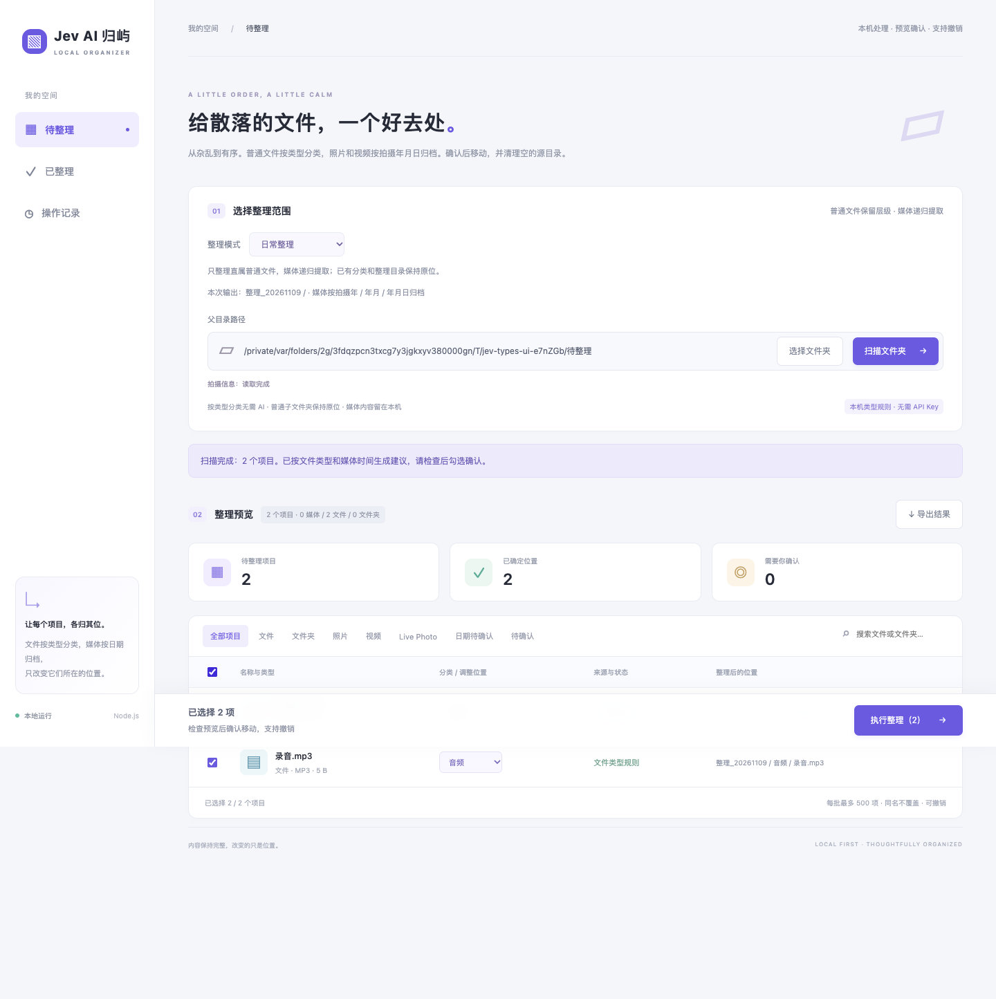
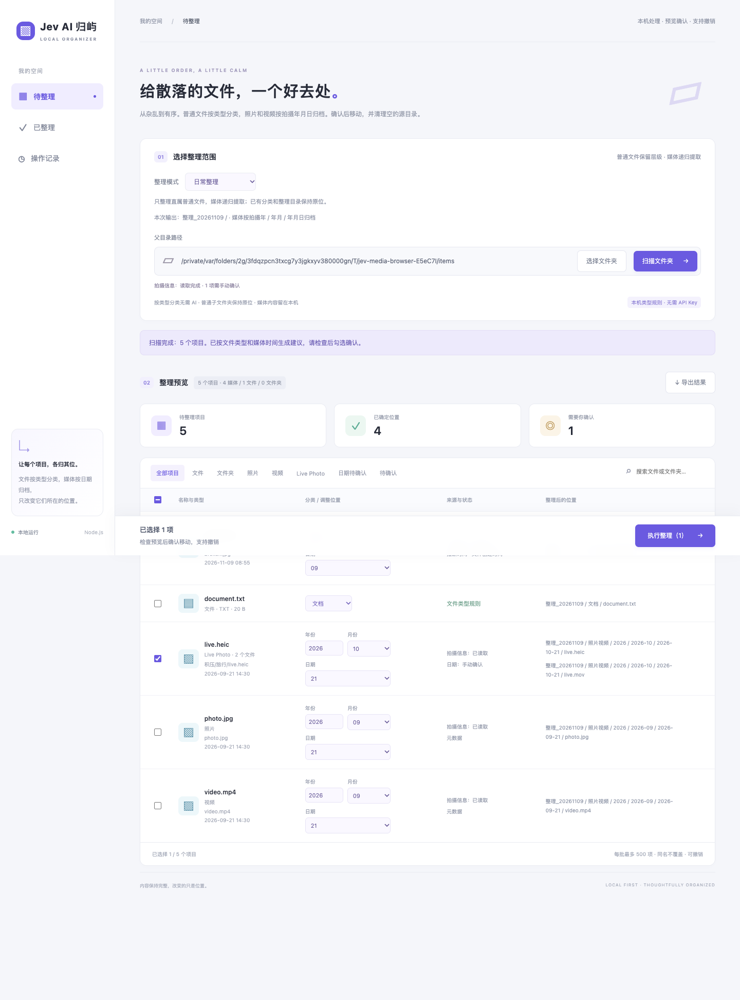
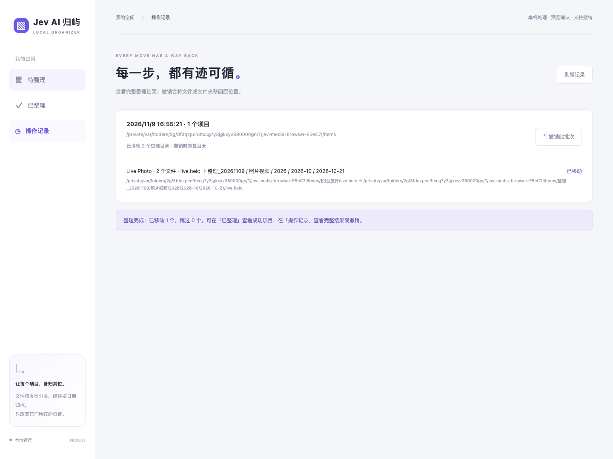
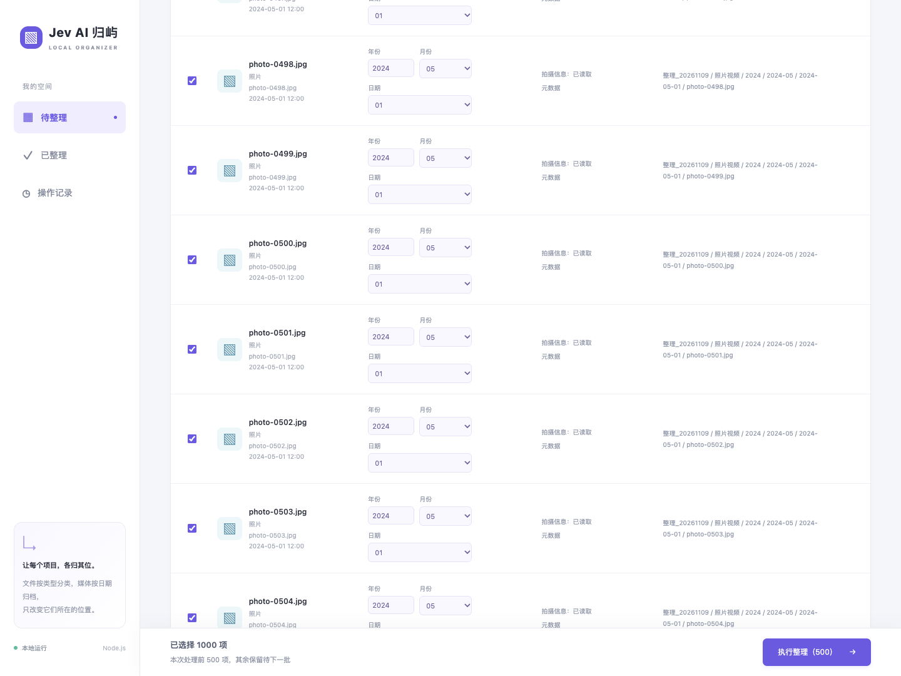
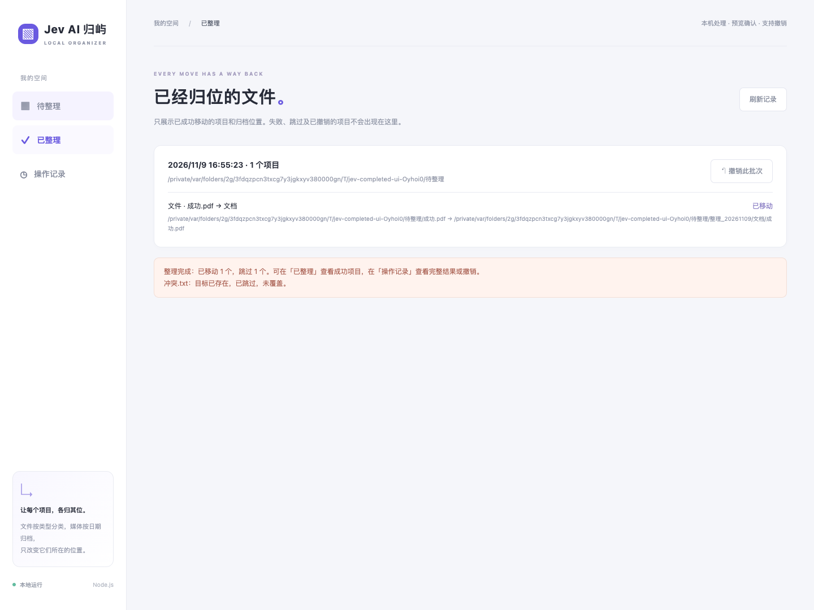
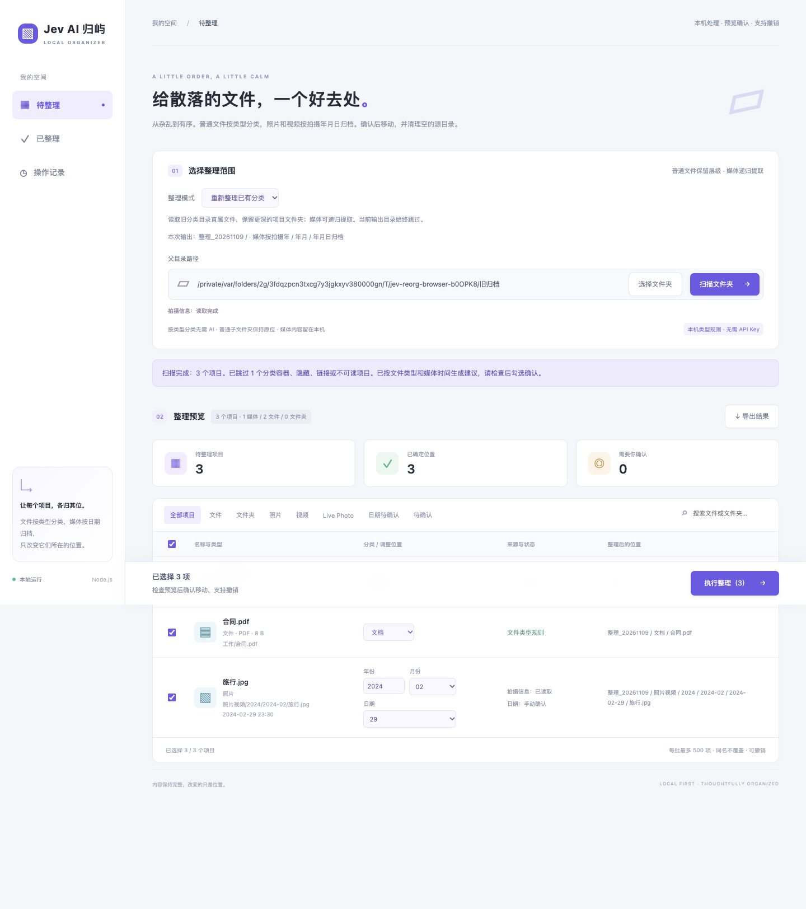

# Jev AI · Guiyu

**Give scattered files a home. Keep photos in time.**

[简体中文](README.md) · [Domain notes](CONTEXT.md) · [Directory recovery](docs/source-directory-recovery.md)

A local file organizer for overflowing downloads and photos buried in nested folders. Guiyu suggests types for ordinary files and collects photos, videos, and Live Photos into daily capture-date archives. **Preview the destination, confirm the move, and keep a reversible record.**

The default workflow needs no AI API key. Your files remain ordinary files on disk, without a proprietary library import.



*Real application screenshots using synthetic test data. The interface is currently in Chinese; this guide explains the workflow in English.*

## A simple structure you can keep

The application uses these Chinese folder names:

```text
Selected folder/
├── 整理_20261109/         # Local scan date; reused on the same day
│   ├── 文档/             # Documents
│   ├── 音频/             # Audio
│   ├── 压缩包/           # Archives
│   ├── 安装包/           # Installer files
│   ├── 其他/             # Other
│   └── 照片视频/         # Photos and videos together
│       ├── 2024/         # Capture calendar date below
│       │   └── 2024-02/
│       │       └── 2024-02-29/
│       └── 日期待确认/   # Date needs review
└── Client project/       # Ordinary project files stay here
```

- **Keep projects together.** Only direct ordinary files receive extension-based type suggestions. Ordinary files inside subfolders stay in place; the folders themselves are not moved.
- **Find buried media.** Supported photos and videos are discovered recursively. Live Photo members move and undo together.
- **Review uncertain dates.** Capture metadata takes priority, followed by dates in filenames. Filesystem-only or missing dates go to the review folder until you confirm a complete year, month, and day.
- **Remove empty shells carefully.** After successful media moves, only source directories made empty by that batch are removed. The selected root, hidden files, ordinary files, and media that failed to move are preserved.
- **Stay in control.** Scanning and suggestions do not move files. Review, select, and confirm up to 500 items per batch. A fixed bottom action bar keeps the selection count and organize button available while scrolling. For larger selections it shows that the first 500 will be processed and the rest kept for the next batch.



## Three steps

1. Choose a source folder and click **扫描文件夹** (Scan folder).
2. Review types, complete media dates, and destination paths. Edit suggestions as needed.
3. Select items, then **执行整理 → 确认移动** (Organize → Confirm move). Use **操作记录 → 撤销此批次** (History → Undo batch) to restore them.

Existing destinations are never overwritten. If multiple entries share a destination, the first successful move keeps it; later conflicting entries stay pending while independent entries continue. Details show the source, destination, and the other source archived in this batch. Adjust a category or capture date and retry, or rename the source in your file manager and rescan. Live Photo conflicts skip the whole pair. Unsafe source/destination nesting still rejects the batch before moving, with the reason and paths shown. Guiyu does not delete suspected duplicates.

Undo recreates source directories removed by Guiyu. If a source location is occupied, a directory was replaced, or file identity changed, the affected operation stops with an error. **Undo is not a backup**; try a small folder first.



## Organize from anywhere in a long list

The fixed bottom action bar keeps the selection count, batch size, and execute button visible. Reserved space keeps the final row clear on desktop and mobile.



## Separate pending and completed views

- **待整理 / Pending** keeps items from the current scan that have not moved successfully, including skipped or failed items for review and retry.
- **已整理 / Completed** lists successful moves and archive paths from durable journals. It survives reloads; successfully undone items disappear from this view.
- **操作记录 / History** retains the complete batch outcomes, including skipped, failed, and undone entries. Rescan after undo to organize the restored source files again.



## Reorganize existing categories

Choose a mode using **整理模式**:

| Mode | Scope |
| --- | --- |
| 日常整理 / Daily organization | Direct ordinary files and nested media; existing category and dated output containers are skipped |
| 重新整理已有分类 / Reorganize existing categories | Ordinary files directly inside recognized old category chains, plus recursive media; deeper project folders stay intact |

Select the common parent of your old categories. Recognized chains include legacy purpose categories, file type folders, date archives, and the current inbox's custom taxonomy. Arbitrary project folders are never treated as ordinary-file extraction containers. Switching modes clears the preview and requires another scan.

The current `整理_YYYYMMDD` destination is always excluded. Runs on the same local day share it; its date is frozen when scanning so a confirmation after midnight keeps the reviewed path. Media is organized as `照片视频/YYYY/YYYY-MM/YYYY-MM-DD` using its capture calendar date. Nothing overwrites an existing destination. Reorganization still requires selection and confirmation, supports empty-source cleanup, and can undo to the old locations.



## Run locally

Requires **Node.js 22.12+** and npm. Media metadata extraction targets **macOS** with a working Swift toolchain. The native helper is built and cached by source hash in `.data/bin/`. Default type suggestions need no TypeSafe API key.

```sh
npm install
npm start
```

Open [http://127.0.0.1:3210](http://127.0.0.1:3210). The start command builds the frontend before launching the local service.

Optional configuration:

```sh
cp .env.example .env
```

Set `PORT` to change the port. Set `TYPESAFE_API_KEY` only for AI suggestions in custom inbox taxonomies. Existing inbox-specific taxonomies take priority and support up to three levels. Scanning and classification never move pending files on their own.

For an already-built runtime with development dependencies removed, start without invoking Vite:

```sh
node --env-file-if-exists=.env src/server.js
```

## Privacy and safety

- Default file type and media date rules run locally, without a cloud model.
- Ordinary file contents are not read. Photo pixels, audio tracks, and thumbnails are not uploaded to AI. Custom inbox requests to TypeSafe contain only names, types, extensions, sizes, and limited directory samples, without absolute paths.
- The UI does not request GPS lookups. The underlying geocoding capability contacts Apple only with explicit permission; raw coordinates are not returned to the browser.
- Hidden directories, symbolic links, Photos libraries, and recognized archive containers are skipped. Export from Photos to an ordinary folder first. macOS `.app` bundles are directories and are not moved as installer files.
- Files, paths, and directory identities are checked again before moving. Partial failures trigger rollback attempts; ambiguous results are recorded as `uncertain`.
- The service binds only to `127.0.0.1` and checks Host, Origin, and the local session token. Keep `.data/`, which contains the journals needed for undo.

## Supported scope

Media candidates: JPG/JPEG, HEIC/HEIF, PNG, TIF/TIFF, DNG, CR2, NEF, ARW, RAF, MOV, MP4, and M4V. Available metadata depends on macOS support. Failed reads are shown for review. Live Photo pairing requires exactly one photo and one video with the same identifier in the same directory; ambiguous candidates remain separate.

Guiyu currently does not analyze image content, delete duplicate photos, organize inside Photos libraries, edit videos, or automatically migrate existing archives. Migration requires explicitly selecting reorganization mode.

## Development

React + Vite provides the UI, Node.js owns local APIs and file operations, and a Swift helper reads media metadata.

```sh
npm run dev          # Node API
npm run dev:ui       # Vite UI in another terminal
npm run check        # Syntax checks and frontend build
npm test             # Node, HTTP, media, and safety regressions
npm run test:e2e     # Chrome browser workflows
npm run build:native # Build the media helper
```

Browser tests use locally installed Chrome. Documentation screenshots use synthetic fixtures, not personal files. See [CONTEXT.md](CONTEXT.md) for the domain model and [directory recovery](docs/source-directory-recovery.md) for cleanup, cross-batch undo, and interrupted-operation handling.
