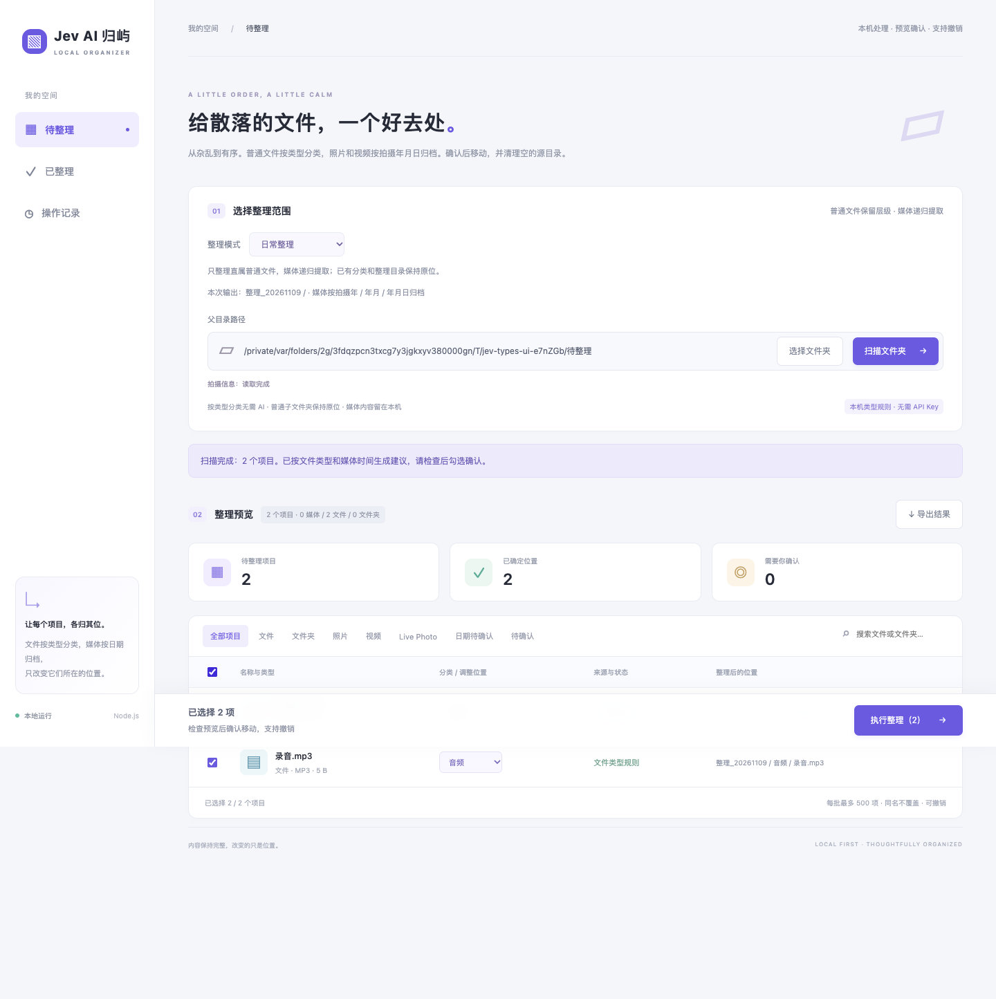
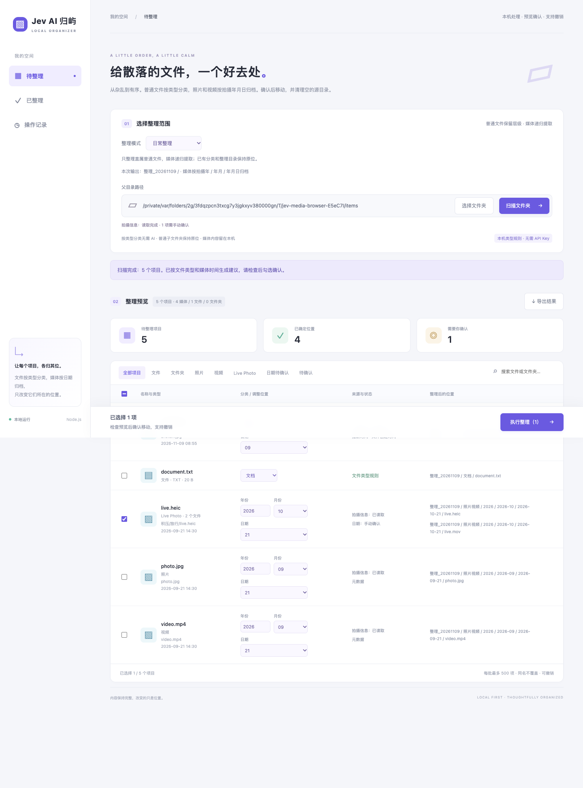
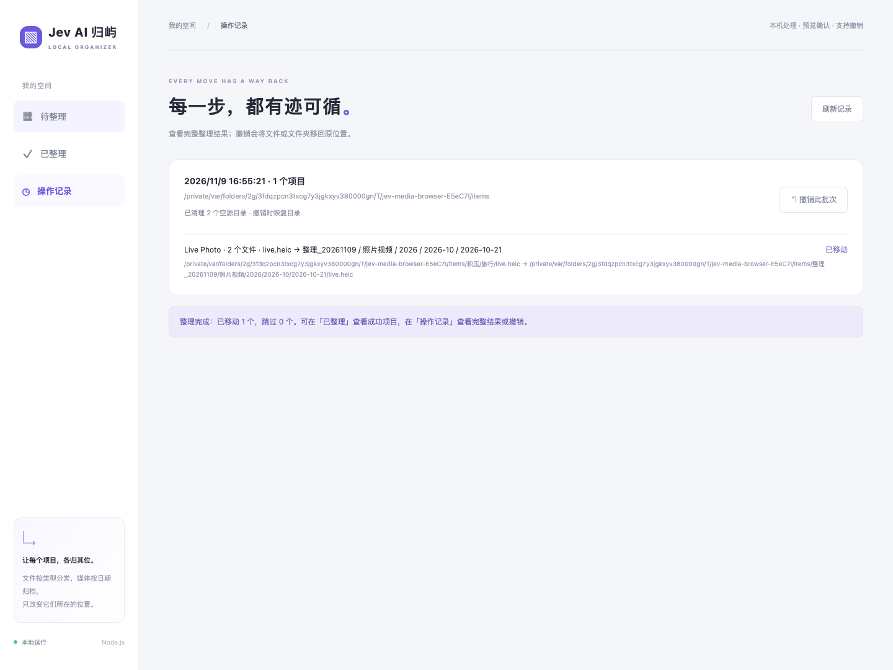
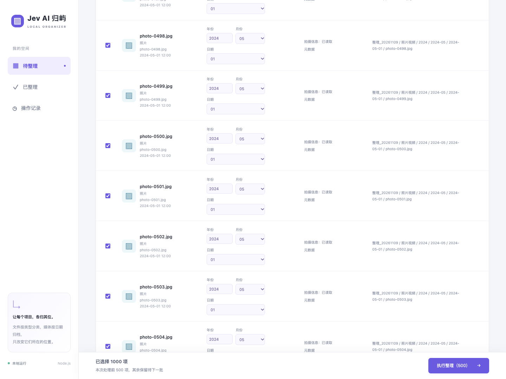
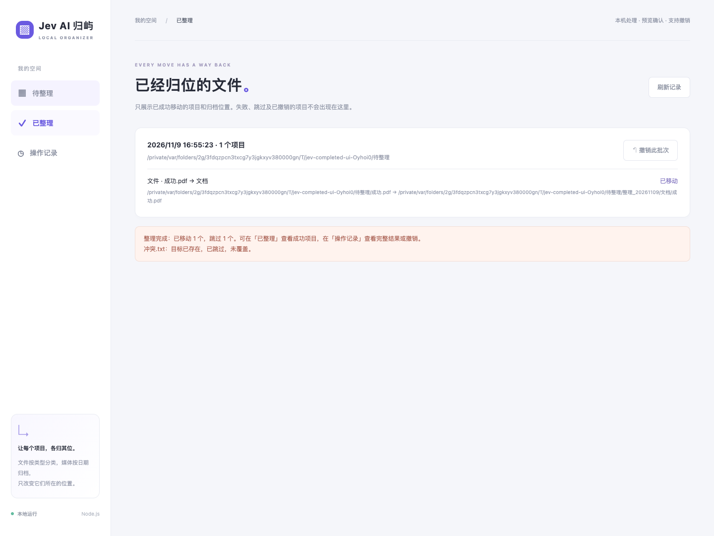
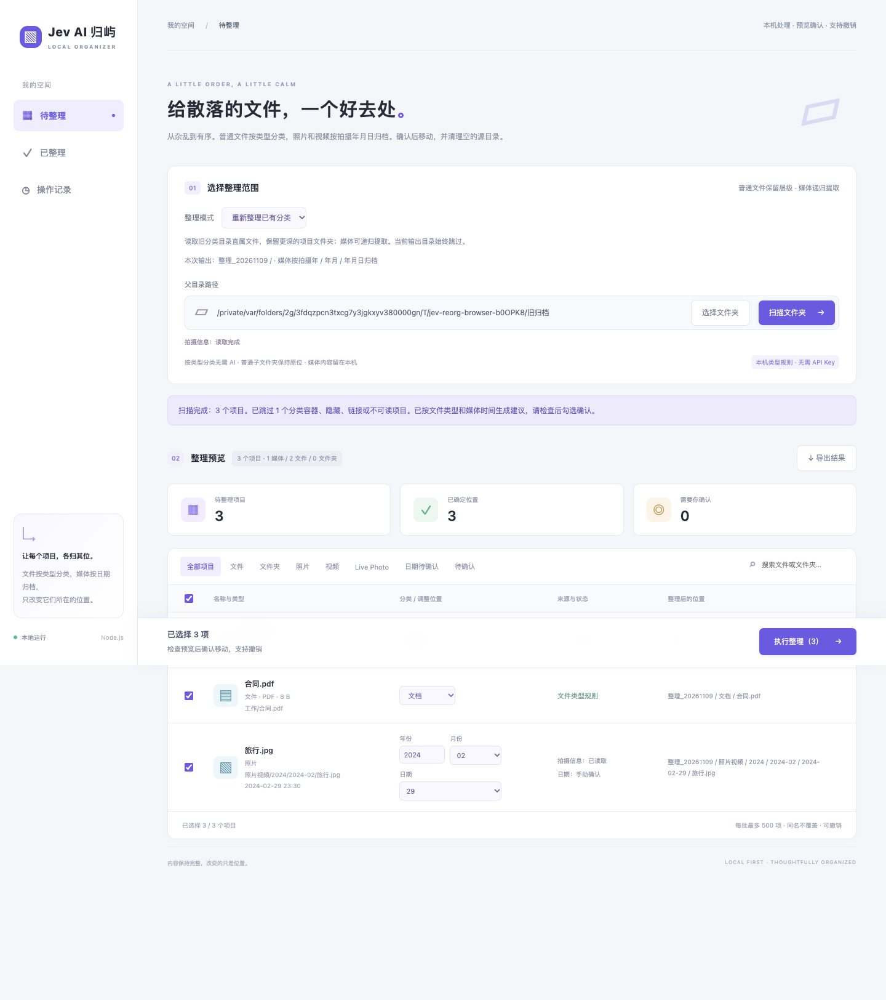

# Jev AI 归屿

**把散落的文件归位，把照片按时间留好。**

[English](README.en.md) · [领域说明](CONTEXT.md) · [恢复机制](docs/source-directory-recovery.md)

下载目录堆满文件，旅行照片散落在几层文件夹里？归屿是一个在本机运行的整理工具：普通文件按类型给建议，照片、视频与 Live Photo 提取后按拍摄年月日归档。**先看预览，再确认移动；每一批都能查看记录和撤销。**

默认整理无需 AI Key。文件保持为磁盘上的普通文件，不需要导入专用资料库。



*实际界面截图，使用合成测试数据。界面目前为中文。*

## 整理之后，目录长这样

```text
待整理目录/
├── 整理_20261109/              # 扫描时的本机日期，同一天复用
│   ├── 文档/
│   ├── 音频/
│   ├── 压缩包/
│   ├── 安装包/
│   ├── 其他/
│   └── 照片视频/
│       ├── 2024/               # 以下使用拍摄日期
│       │   └── 2024-02/
│       │       └── 2024-02-29/
│       └── 日期待确认/
└── 客户项目/                   # 普通项目文件夹保留
```

- **普通文件不拆项目。** 只为所选目录直属的普通文件按扩展名建议类型；子文件夹中的普通文件留在原位，文件夹不整体移动。
- **媒体可以从深处找出来。** 递归发现支持的照片和视频，统一放到“照片视频”；Live Photo 的照片与视频成员一起移动、一起撤销。
- **日期不确定就留下确认。** 优先使用拍摄元数据，再尝试文件名日期。只有文件创建时间或缺少完整年月日时进入“日期待确认”；可手动修改年月日。
- **不留空壳，也不误删内容。** 仅清理由本批成功提取媒体造成的空源目录；保留扫描根目录，有普通文件、隐藏文件或未移动媒体的目录都会保留。
- **你的确认才会改变位置。** 扫描和分类都不移动文件。检查目标路径、勾选项目并确认后执行，每批最多 500 项。底部操作栏始终显示已选数量和执行按钮，无需滚动到列表末尾；选择超过 500 项时，会提示本次处理前 500 项，其余保留。



## 三步开始

1. 选择待整理目录，点击 **扫描文件夹**。
2. 检查文件类型、媒体年月日和整理后的路径，修改需要调整的建议。
3. 勾选项目，点击 **执行整理 → 确认移动**。成功项目会从 **待整理** 移到 **已整理**；需要回退时，可在 **已整理** 或 **操作记录** 中撤销此批次。

同名目标不会被覆盖。同一批多个来源指向相同目标时，保留先成功移动的一份，后续冲突项留在待整理列表，无冲突项目继续。提示会列出来源、目标和本批已归档的另一来源；可调整分类或拍摄日期后重试，或在系统中重命名后重新扫描。Live Photo 冲突时整组跳过。源目录与目标目录互相包含等危险重叠仍会阻止整批，并列出原因与路径。归屿不会自行删除疑似重复文件。

撤销会重建本工具清理的源目录；如果原位置被占用、目录被替换或文件身份变化，工具会停止相应操作并显示错误。**撤销不替代备份**，首次使用可先选一个小目录体验。



## 长列表也能随时执行

不必滚到底部。固定操作栏始终显示已选数量、当前批次数量和执行按钮；末行保留足够空间，桌面和手机都可操作。



## 待整理和已整理，分开看

- **待整理**：当前扫描中尚未成功移动的项目；失败或跳过的项目保留，方便检查后重试。
- **已整理**：由持久化操作日志生成，只显示成功移动的项目及归档路径，刷新后仍能查看。撤销成功后，对应项目从此页移除。
- **操作记录**：保留成功、跳过、失败、已撤销等完整批次结果。撤销后重新扫描，即可再次整理恢复到原位的文件。



## 已整理过的文件，也能重新归位

在 **整理模式** 中选择：

| 模式 | 扫描范围 |
| --- | --- |
| 日常整理 | 直属普通文件与嵌套媒体；跳过已有分类和 `整理_年月日` 目录 |
| 重新整理已有分类 | 允许读取旧分类和旧日期归档；只提取已知分类容器直属普通文件，更深的项目文件夹继续保留；媒体递归提取 |

请选中包含旧分类的共同父目录。可识别“工作、学习、生活、影音、软件”等旧分类、文件类型目录、日期归档和当前收件箱自定义分类链；不会把任意项目子文件夹当成普通文件收集区。切换模式后需要重新扫描。

本次目标 `整理_YYYYMMDD` 无论哪种模式都排除，避免将刚归档的内容再次扫描。同日再次整理复用该目录；日期以扫描预览为准，跨午夜确认也不会改变目标。已存在的同名目标不覆盖。重新整理需要同样的预览、勾选和确认，也支持清理空源目录和撤销到旧位置。



## 本机启动

需要 **Node.js 22.12+** 和 npm。媒体元数据读取面向 **macOS**，需要可用的 Swift 工具链；原生 helper 按源码哈希构建并缓存于 `.data/bin/`。普通文件类型建议无需 TypeSafe API Key。

```sh
npm install
npm start
```

打开 [http://127.0.0.1:3210](http://127.0.0.1:3210)。`npm start` 会先构建界面，再启动本机服务。

可选配置：

```sh
cp .env.example .env
```

修改 `PORT` 可调整端口。只有需要自定义收件箱的 AI 分类建议时，才需要配置 `TYPESAFE_API_KEY`。已有收件箱的自定义分类体系优先保留，支持最多三级；AI 建议和手动修改不会在扫描时直接移动项目。

已经构建并删除开发依赖的运行环境，请用以下命令启动，避免再次调用 Vite：

```sh
node --env-file-if-exists=.env src/server.js
```

## 隐私与可控性

- 默认文件类型和媒体时间规则都在本机执行，无需云端模型。
- 不读取普通文件正文，不向 AI 上传照片像素、音轨或缩略图。自定义收件箱使用 TypeSafe 时，仅发送名称、类型、扩展名、大小和有限目录样本，不发送绝对路径。
- 页面不发起 GPS 地点查询；底层地点解析仅在显式允许时调用 Apple，原始坐标不返回浏览器。
- 跳过隐藏目录、符号链接、Photos 图库和已识别的归档容器。Photos 图库需先导出到普通文件夹；macOS 的 `.app` 包是目录，不作为安装包文件搬走。
- 移动前重新校验源文件、路径和目录身份。不覆盖目标；部分移动失败尝试回滚，无法确认的状态会明确标为 `uncertain`。
- 服务只监听 `127.0.0.1`，并校验 Host、Origin 和本机会话 token。操作日志和运行数据保存在 `.data/`，请妥善保留以便撤销。

## 支持范围

媒体候选格式：JPG/JPEG、HEIC/HEIF、PNG、TIF/TIFF、DNG、CR2、NEF、ARW、RAF，以及 MOV、MP4、M4V。实际可读取的元数据取决于 macOS 支持；读取失败会显示待确认，不会假装识别成功。Live Photo 配对要求同目录、同标识且恰好一张照片与一个视频，配对有歧义时分开展示。

工具当前不做画面识别、重复照片删除、Photos 图库内整理或视频剪辑；迁移已有归档需要显式选择重新整理模式。

## 开发与验证

React + Vite 负责界面，Node.js 负责本机 API 与文件操作，Swift helper 读取媒体元数据。

```sh
npm run dev          # Node API
npm run dev:ui       # Vite 界面（另开终端）
npm run check        # 语法检查与前端构建
npm test             # Node、HTTP、媒体与安全回归
npm run test:e2e     # Chrome 浏览器流程
npm run build:native # 构建媒体 helper
```

浏览器测试使用本机 Chrome。截图来自浏览器回归中的合成数据，未使用个人文件。实现入口见 [CONTEXT.md](CONTEXT.md)；空目录清理、跨批次撤销与中断保护见 [恢复机制说明](docs/source-directory-recovery.md)。
